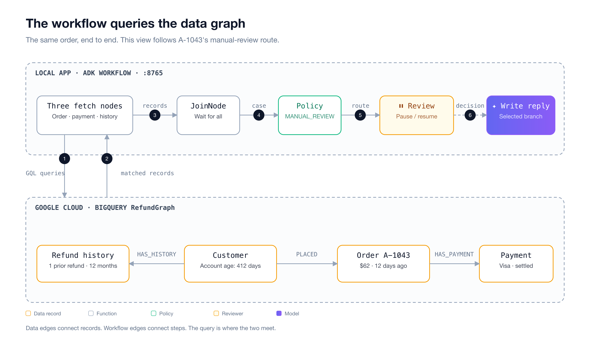

# One refund, two graphs

Why do graphs keep showing up in AI? This demo answers it with one refund request (order A-1043) and two kinds of graph:

- **Workflow graph** — an ADK 2 `Workflow` controls execution: three parallel reads, a join, a policy decision, a human review pause, and a drafted reply.
- **Data graph** — a BigQuery property graph connects the order, payment, customer, and refund history the workflow needs.

The workflow queries the data graph to get its facts. The browser app shows both, then puts them together.



## Run it

You need `uv`, Python 3.10–3.13, and the Google Cloud CLI.

```bash
uv sync --locked
make playground
```

Open http://127.0.0.1:8765.

1. **Workflow** — click "Run refund check". Three live BigQuery reads finish, then the policy returns `MANUAL_REVIEW` and the run pauses.
2. **Data graph** — look at the connected records for the same order. "Query and execution record" shows the GQL, job ID, parameters, and returned paths.
3. **Together** — enter a reviewer reason and choose Approve or Decline. The same ADK session resumes, only the chosen response node runs, and Gemini drafts the reply.

"Expand diagram" enlarges any view for recording; Escape closes it. No payment or email is ever sent.

The app uses your current `gcloud` identity. It needs permission to query the dataset and call Vertex AI.

## Your own project

Defaults live in `app/config.py`. To create the dataset in your project:

```bash
export REFUND_BQ_PROJECT=your-project
export REFUND_BQ_DATASET=refund_graph_demo
make setup
```

Keep those variables set when you start the server. Setup creates seven one-row tables (`Customers`, `Orders`, `Payments`, `RefundHistory`, `CustomerOrders`, `OrderPayments`, `CustomerHistory`) and the `RefundGraph` property graph. It never replaces existing tables.

GQL (`MATCH`) needs an Enterprise or Enterprise Plus reservation — see [BigQuery Graph requirements](https://docs.cloud.google.com/bigquery/docs/graph-overview). Creating the graph doesn't copy any table data ([graph creation](https://docs.cloud.google.com/bigquery/docs/graph-create)).

The model is `gemini-3-flash-preview` on Vertex AI, location `global`.

## The data

All records are fictional teaching data from the refund example in my ADK 2 workflows blog post (`refund_static.py`). `data/source-fixture.json` keeps the original values and the file's SHA-256.

| Fact | Value |
| --- | --- |
| Order | A-1043 |
| Item | trail running shoes |
| Amount | USD 62.00 |
| Order age | 12 days |
| Payment | visa; settled; no open chargeback |
| Account age | 412 days |
| Prior refunds | 1 in the last 12 months |

The customer, payment, and history IDs are modeling IDs added to turn the example into graph nodes.

## Code map

| File | What it does |
| --- | --- |
| `app/workflow.py` | ADK `Workflow`: parallel fetches, `JoinNode`, policy routing, `RequestInput`, resume |
| `app/data.py` | Parameterized GQL queries on BigQuery Graph, with job metadata |
| `app/policy.py` | Refund policy |
| `app/agent.py` | Reply-drafting agent |
| `app/server.py` | Local API and review endpoint |
| `static/` | Browser UI and diagrams |
| `scripts/setup_bigquery.py` | Creates the tables and graph |
| `sql/` | Setup SQL and the exact app queries |

The data view fetches everything in one query; the workflow uses three on purpose, to show parallel branches and a join. BigQuery is an analytics system — this is a teaching app, not a pattern for a low-latency refund backend.

## Tests

| Command | What it checks |
| --- | --- |
| `make test` | Offline policy and control-flow tests |
| `make verify-live` | Real BigQuery + ADK + Gemini runs, approve and decline |
| `make eval` | ADK eval of the reply agent |
| `make lint` | Python errors and JavaScript syntax |

`evidence/` has the results from my runs: setup check, both live runs with query IDs and traces, the eval result, and UI screenshots.

## Limits

Local demo only: in-memory sessions, no refunds or emails, no auth. Production would need persistent state, authorization, retries, and idempotent external actions.
